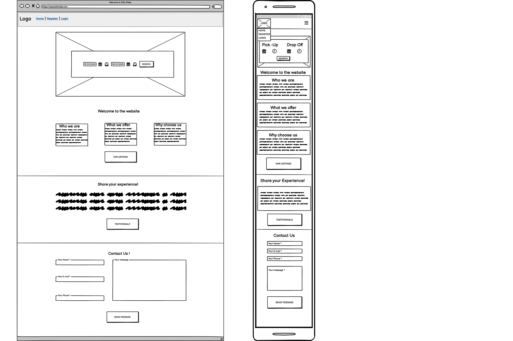
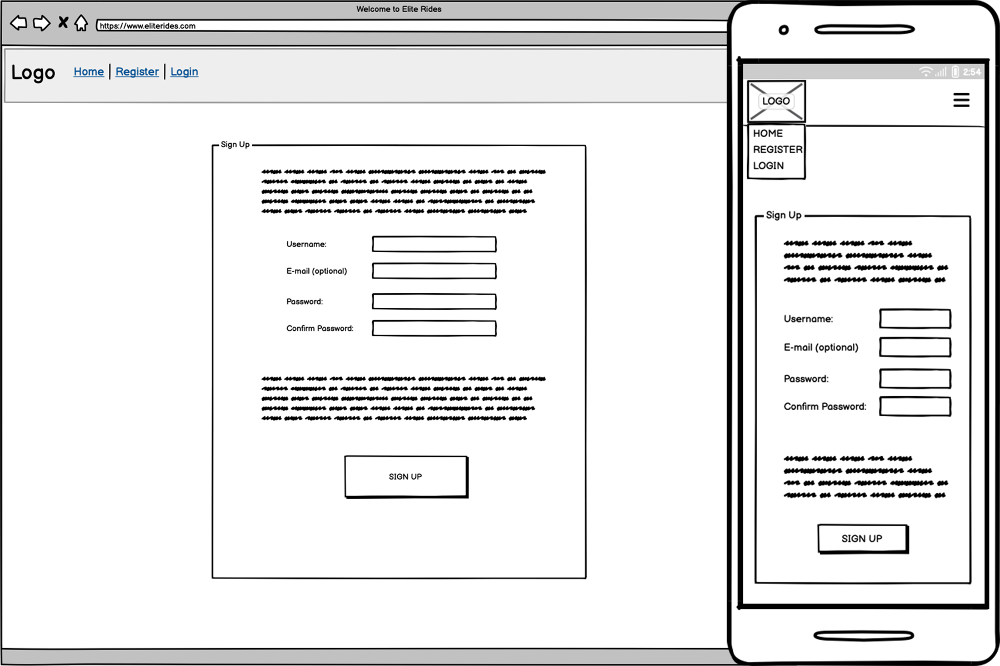
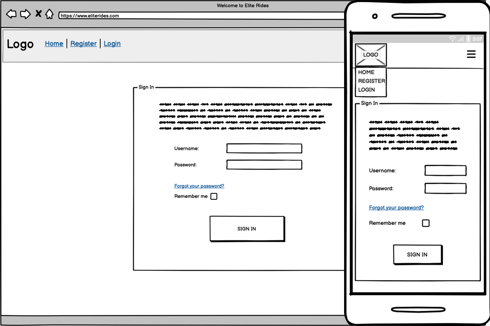
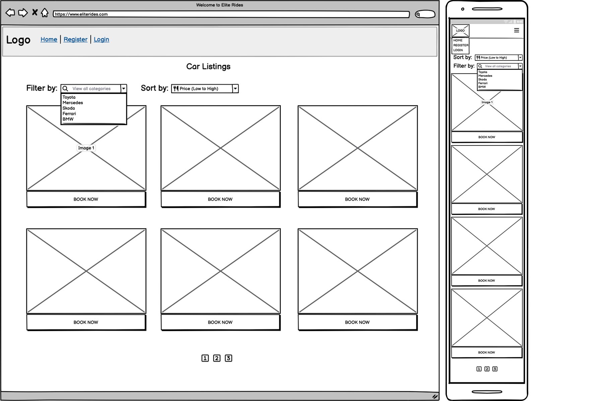
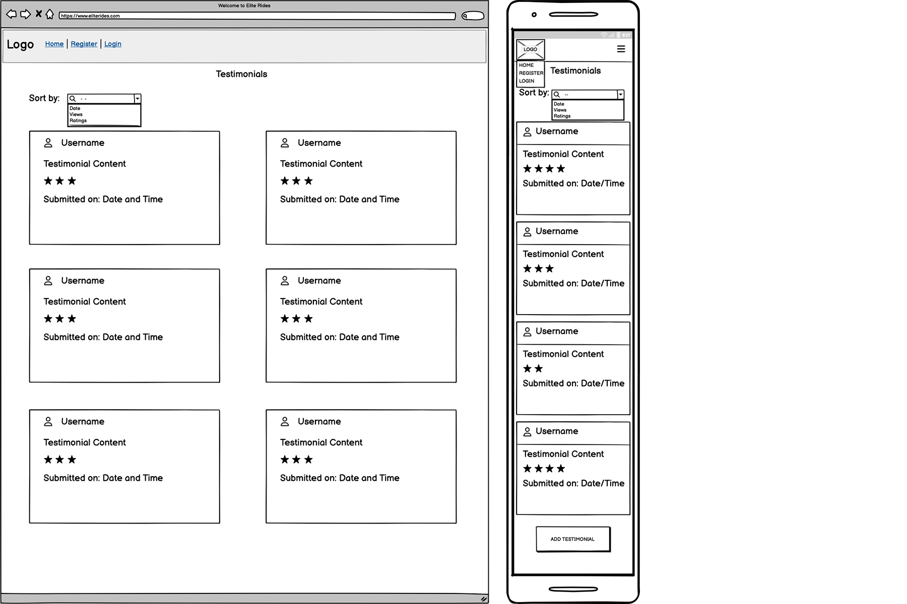
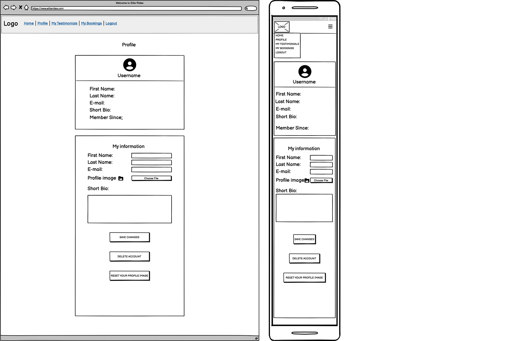
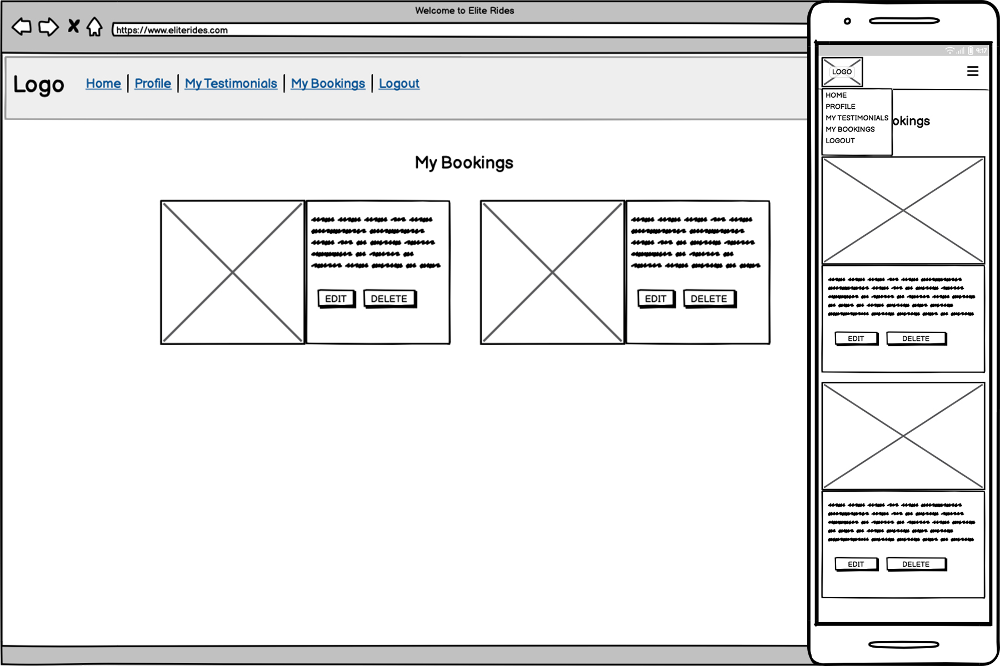
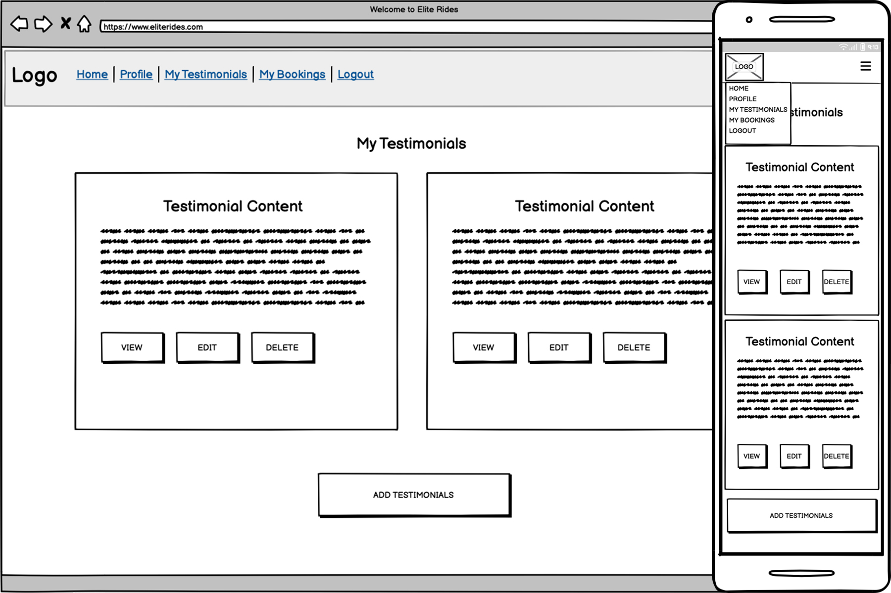

<h1 align="center">🏎 Elite Rides Car Rental 🏎</h1>

* [Elite Rides Car Rental](#elite-rides-car-rental)
* [User Experience Design](#user-experience-design)
    * [The Strategy Plane](#the-strategy-plane)
        * [Site Goals](#site-goals)
        * [Agile Planning](#agile-planning)
            * [Epics](#epics)
            * [User Stories](#user-stories)
    * [The Scope Plane](#the-scope-plane)
    * [The Structure Plane](#the-structure-plane)
       * [Features](#features)
       * [Future Enhancements](#future-enhancements)
    * [The Skeleton Plane](#the-skeleton-plane)
       * [Wireframes](#wireframes)
       * [Database Design](#database-design)
       * [Security](#security)
    * [The Surface Plane](#the-surface-plane)
       * [Design](#design)
       * [Color Scheme](#color-scheme)
       * [Typography](#typography)
       * [Imagery](#imagery)
   * [Technologies Used](#technologies-used)
   * [Manual Testing](#manual-testing)
       * [Fixed Bugs](#fixed-bugs)
       * [Unfixed Errors](#unfixed-errors)
   * [Deployment](#deployment)
       * [Version Control](#version-control)
       * [Heroku Deployment](#heroku-deployment)
       * [Run Locally](#run-locally)
       * [Fork Project](#fork-project)
   * [Credits](#credits)

# User Experience Design

## The Strategy Plane

### Site Goals
### Agile Planning

#### Epics
#### User Stories

**Epic 1: Accounts and access**

- As a visitor, I can register an account, so that I can book cars.
- As a customer, I can log in and out, so that my bookings stay private.
- As a user, I can see whether I'm logged in, so that I know my session state.
- As a visitor, I'm redirected to the login page when I open a booking page, so that restricted pages stay protected.
- As a user, I can reset a forgotten password.

**Epic 2: Browse the fleet**

- As a visitor, I can browse the available cars, so that I can see what's on offer.
- As a visitor, I can open a car's detail page (price per day, seats, transmission), so that I can decide.
- As a visitor, I can filter cars by category, so that I can narrow my choice.
- As a visitor, I can search by make or model.

**Epic 3: Reservations**

- As a customer, I can book a car for a date range, so that it's reserved for me.
- As a customer, I'm told when my dates aren't available, so that I can choose others.
- As a customer, I can see all my bookings, so that I can keep track of them.
- As a customer, I can edit my booking's dates, so that I can change my plans.
- As a customer, I can cancel a booking after a confirmation step, so that I don't hold a car I don't need.
- As a staff member, I can approve or decline reservations.

**Epic 4: Fleet management**

- As a staff member, I can add, edit and delete (or deactivate) cars and upload an image for each, so that the fleet stays up to date.

**Epic 5: Testimonials**

- As a customer, I can write, edit and delete my own testimonial, so that I can share my experience.
- As a staff member, I can approve testimonials before they show.

**Epic 6: Site information**
- As a visitor, I understand what the site offers from the homepage and can navigate it easily.
- As a visitor, I can send a message through a contact form.

## The Scope Plane

## The Structure Plane

### Features
### Future Enhancements

## The Skeleton Plane

### Wireframes

Homepage

Register

Login

Cars

Testimonials

Profile

My Bookings

My Testimonials

### Database Design
### Scurity

## The Surface Plane

### Design
### Color Scheme
### Typography
### Imagery

## Technologies Used

## Manual Testing

### Fixed Bugs
### Unfixed Errors

## Deployment

### Version Control

### Heroku Deployment

### Run Locally

### Fork Project

## Credits

