<h1 align="center">🏎 Elite Rides Car Rental 🏎</h1>

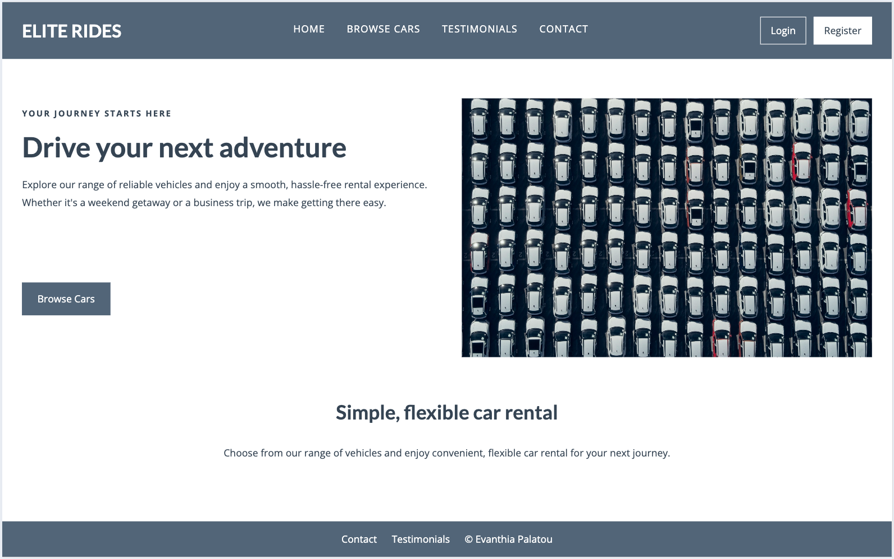

## Overview
Elite Rides is a web-based car rental platform designed to make finding and booking a rental car simple and convenient. The website allows visitors to browse a selection of available vehicles, explore individual car details and choose a vehicle that suits their travel needs. With a clean and responsive interface, Elite Rides aims to provide a straightforward experience across desktop, tablet and mobile devices. Registered customers can manage their reservations, view their booking history and share their experiences through testimonials. The platform also provides a contact form for enquiries, making it easy for customers to get in touch.

## Purpose
The purpose of Elite Rides is to provide a user-friendly car rental application that streamlines the vehicle browsing and reservation process for customers while allowing administrators to manage the platform efficiently. Customers can create an account, browse available cars, make reservations, manage their bookings and submit testimonials. Administrators have access to dedicated management functionality, allowing them to add, edit and remove vehicles, oversee reservations, manage customer enquiries and approve testimonials. The project brings together customer-facing features and administrative tools in one full-stack web application, providing a practical and accessible solution for managing a car rental service.

* [Elite Rides Car Rental](#elite-rides-car-rental)
* [User Experience Design](#user-experience-design)
    * [The Strategy Plane](#the-strategy-plane)
        * [Site Goals](#site-goals)
        * [Agile Planning](#agile-planning)
            * [Epics](#epics)
            * [User Stories](#user-stories)
    * [The Scope Plane](#the-scope-plane)
    * [The Structure Plane](#the-structure-plane)
       * [Features](#features)
       * [Future Enhancements](#future-enhancements)
    * [The Skeleton Plane](#the-skeleton-plane)
       * [Wireframes](#wireframes)
       * [Database Design](#database-design)
       * [Security](#security)
    * [The Surface Plane](#the-surface-plane)
       * [Design](#design)
       * [Color Scheme](#color-scheme)
       * [Typography](#typography)
       * [Imagery](#imagery)
   * [Technologies Used](#technologies-used)
   * [Manual Testing](#manual-testing)
       * [Fixed Bugs](#fixed-bugs)
       * [Unfixed Errors](#unfixed-errors)
   * [Deployment](#deployment)
       * [Version Control](#version-control)
       * [Heroku Deployment](#heroku-deployment)
       * [Run Locally](#run-locally)
       * [Fork Project](#fork-project)
   * [Credits](#credits)

# User Experience Design

## The Strategy Plane

### Site Goals
- Provide a fully responsive, user-friendly platform for customers to browse available rental cars.
- Allow visitors to explore individual vehicles and view their specifications, features and rental prices.
- Enable registered customers to create accounts, make reservations and manage their bookings.
- Provide secure user and administrator access with appropriate permissions.
- Allow administrators to manage vehicles, reservations, customer enquiries and testimonials through dedicated management features.
- Offer customers a convenient way to contact the business and share their experiences through testimonials.
- Create a reliable and straightforward car rental experience across desktop, tablet and mobile devices.

### Agile Planning
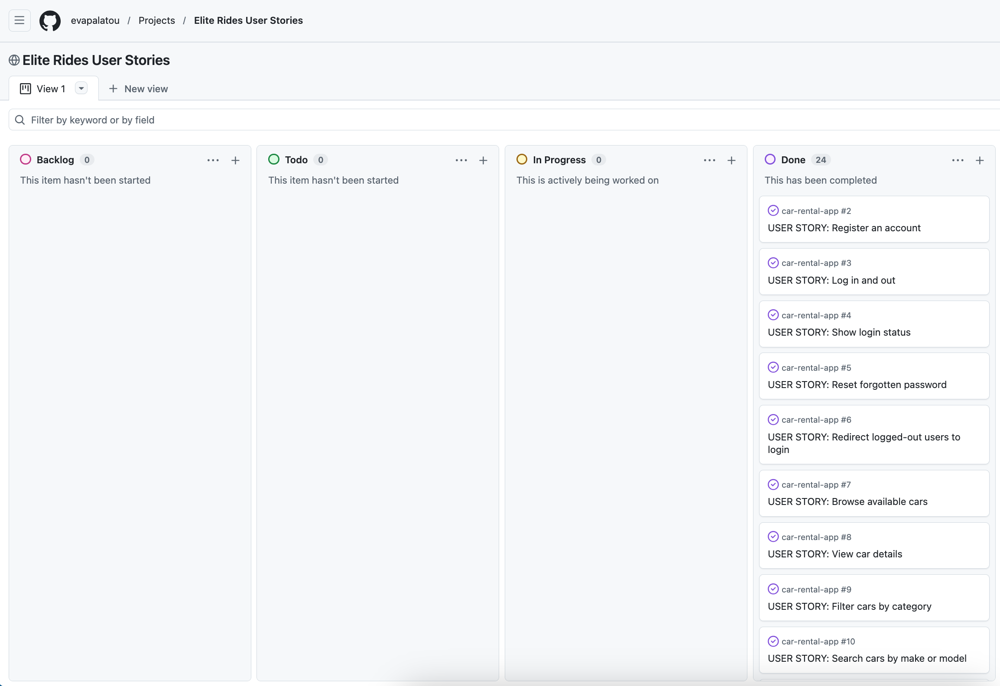
Elite Rides Car Rental was developed using Agile methodologies, with tasks organised and tracked through a GitHub Projects Kanban board. The project was divided into manageable user stories, allowing development to progress in small, structured steps. Each user story includes acceptance criteria to define the expected functionality and establish clear conditions for completion. GitHub Issues were used to document individual tasks, track progress and organise development work. Labels helped categorise issues and distinguish different types of work. The Kanban board provided an overview of the project's progress, with user stories moved through the relevant stages as development and testing progressed. This approach helped prioritise essential features, monitor completed work and identify outstanding tasks. For more details, you can view the [Agile Planning Board](https://github.com/users/evapalatou/projects/4) and the [project repository](https://github.com/evapalatou/car-rental-app).

### User Stories: [Car Rental Kanban Board](https://github.com/users/evapalatou/projects/4)

**Epic 1: Accounts**
- As a new user, I want to register an account so that I can book cars.
- As a site user, I want to log in and out so that my bookings stay private.
- As a site user, I want to see that I’m logged in so that I know my session state.
- As a site user, I want to reset a forgotten password so that I can get back into my account.
- As a new user, I want to be sent to the login page if I open a booking page so that restricted pages stay protected.

**Epic 2: Browse Cars and Navigate**
- As a new user, I want to browse the available cars so that I can see what’s on offer.
- As a new user, I want to view a car’s details so that I can decide if it suits me.
- As a new user, I want to filter cars by category so that I can narrow my choice.
- As a new user, I want to search for cars by make or model so that I can find a specific car quickly.
- As a new user, I want to understand what the site offers so that I can quickly reach the cars.

**Epic 3: Reservations**
- As a site user, I want to book a car for a date range so that it’s reserved for me.
- As a site user, I want to be told when my dates aren’t available so that I can choose others.
- As a site user, I want to see my bookings so that I can keep track of them.
- As a site user, I want to edit my booking so that I can change my plans.
- As a site user, I want to cancel my booking so that I don’t hold a car I don’t need.
- As a site admin, I want to approve or decline reservations so that I control the fleet.
- As a site user, I want to receive an email about my reservation so that I have a record of it.

**Epic 4: Fleet Management**
- As a site admin, I want to add a car so that the fleet stays up to date.
- As a site admin, I want to edit a car so that I can change its price or details.
- As a site admin, I want to delete a car so that unavailable cars are removed.

**Epic 5: Contact**
- As a new user, I want to send a message through a contact form so that I can ask the owner a question.
- As a site admin, I want to read the contact messages so that I can reply to them.

**Epic 6: Testimonials**
- As a site user, I want to write a testimonial so that I can share my experience.
- As a site admin, I want to approve testimonials so that I control what shows.

## The Scope Plane
At the beginning of the Elite Rides project, I identified the essential features needed to create a functional car rental platform. To manage the project scope, prioritise development and avoid scope creep within the available timeframe, I used the MoSCoW prioritisation method. This approach helped me distinguish between essential features required for the minimum viable product and additional functionality that could be considered for future development.

**Must Have**
- User registration, login and logout.
- Password recovery.
- Browse available rental cars.
- View individual car details.
- Search cars by make or model.
- Filter cars by category.
- Make a reservation by selecting rental dates.
- Check car availability and prevent overlapping reservations.
- View, edit and cancel personal reservations.
- Email notifications relating to reservations.
- Administrator access with appropriate permissions.
- Full CRUD functionality for car management.
- Administrator ability to approve or decline reservations.
- Contact form for customer enquiries.
- Administrator ability to manage contact messages.
- Customer testimonials and administrator approval.
- Responsive design for desktop, tablet and mobile devices.

**Should Have**
- A dedicated homepage introducing the car rental service.
- Clear navigation for customers and administrators.
- Informative confirmation and feedback messages.
- A straightforward and accessible user experience.

**Could Have**
- Online payment integration.
- Customer profile management.
- Automated booking reminders.
- Additional vehicle filtering options.

**Won't Have**
- Online payment processing.
- A loyalty or rewards programme.
- A live chat support system.
- A mobile application.
- Integration with external car rental or fleet management services.

## The Structure Plane
### Flow Chart
To help with the website I created a flowchart using [Draw.io](https://draw.io/)
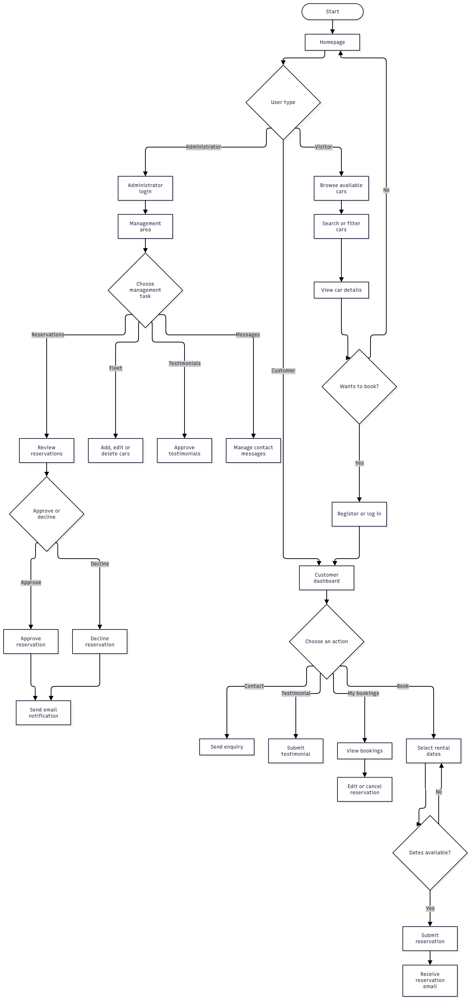

### Features

<strong>Navigation & Footer</strong>

The navigation bar displays the ELITE RIDES logo and website name, which also serves as a link to the homepage. It provides access to the main sections of the website. Visitors who are not logged in can access the Register and Login options. Once logged in, customers can access their account features, including My Bookings, and the Logout option. Additional management links are available to staff users. The footer displays © 2026 Evanthia Palatou, followed by links to LinkedIn and GitHub, represented by social media icons.

 
 

<strong>Home Page</strong>

When users visit Elite Rides, they are welcomed by the homepage, which introduces the car rental service through a clear heading, descriptive text and a featured car image. A Browse Cars button directs visitors to the available vehicles, where they can explore the fleet and find a car that suits their needs. The responsive layout adapts to desktop, tablet and mobile screens, providing a consistent browsing experience across devices.

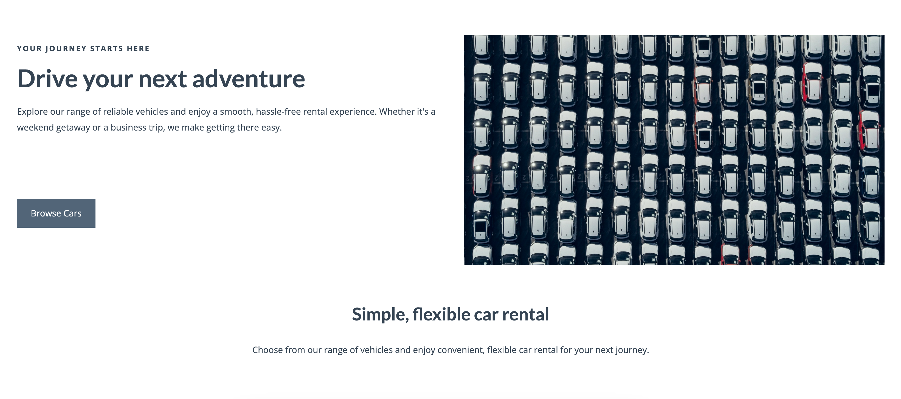 

<strong>Registration Page</strong>

New users can create an account through the Sign Up page by providing a username, email address and password. The form includes password confirmation and validation to ensure that passwords meet the required security criteria. Existing users can follow the Sign In link to access their accounts. After successful registration, users are redirected to the homepage and shown a confirmation message.

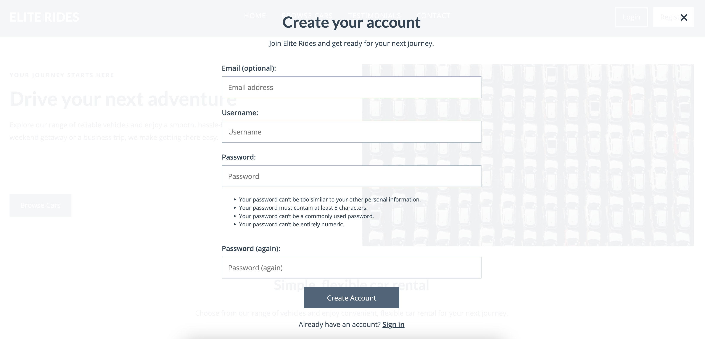 

<strong>Login Page</strong>

Registered customers can access their accounts through the Login page by entering their username and password. The page also provides a Forgot Password? link to help users reset their password if needed. After successfully logging in, customers are redirected to the homepage and shown a confirmation message.

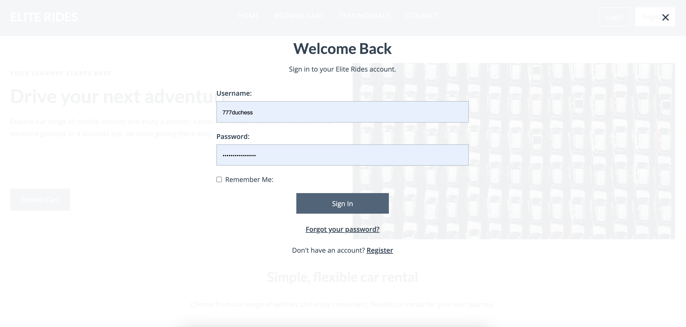 

<strong>Browse Cars Page</strong>

The Browse Cars page allows users to explore the available rental vehicles. Each car is displayed in its own card, showing an image, make and model, category, transmission, seating capacity and daily rental price. Users can search for a specific vehicle by make or model and filter the results by car category. Each card also includes a View Details button, allowing users to access more information about the selected vehicle and proceed with a reservation.

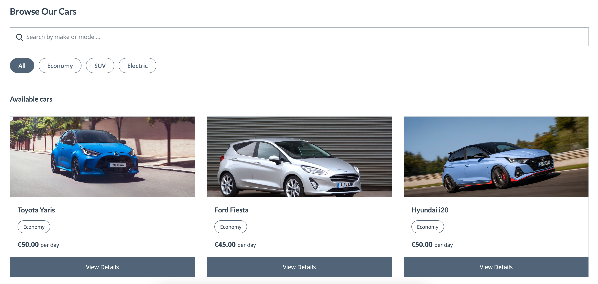 

<strong>Testimonials Page</strong>

The Testimonials page allows visitors to read feedback shared by customers about their experience with Elite Rides. Each approved testimonial displays the customer's name, rating, message and submission date. Registered customers can submit their own testimonials through the Add Your Testimonial option. Submitted testimonials require administrator approval before appearing publicly on the website.

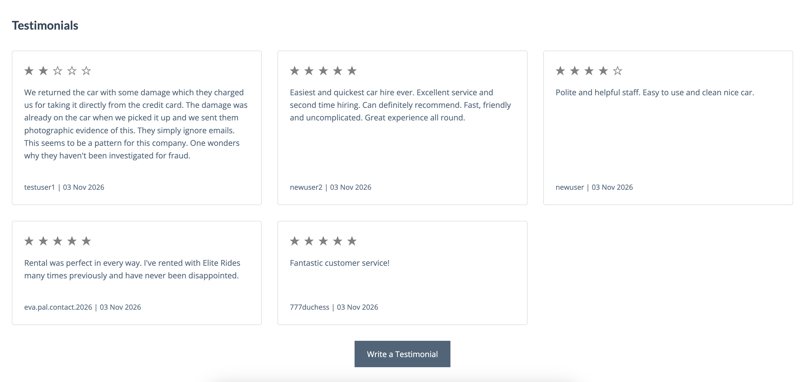 

<strong>Contact Page</strong>

The Contact page provides visitors with a convenient way to get in touch with Elite Rides. The contact form allows users to submit an enquiry by providing their name, email address and message. Once submitted, a confirmation message informs them that their enquiry has been received.

The form includes the following fields:
- Name (required)
- Email Address (required)
- Message (required)
- A Send Message button allows users to submit their enquiry.

Administrators can access the submitted enquiries through a dedicated management page, where they can review customer messages and manage incoming enquiries.

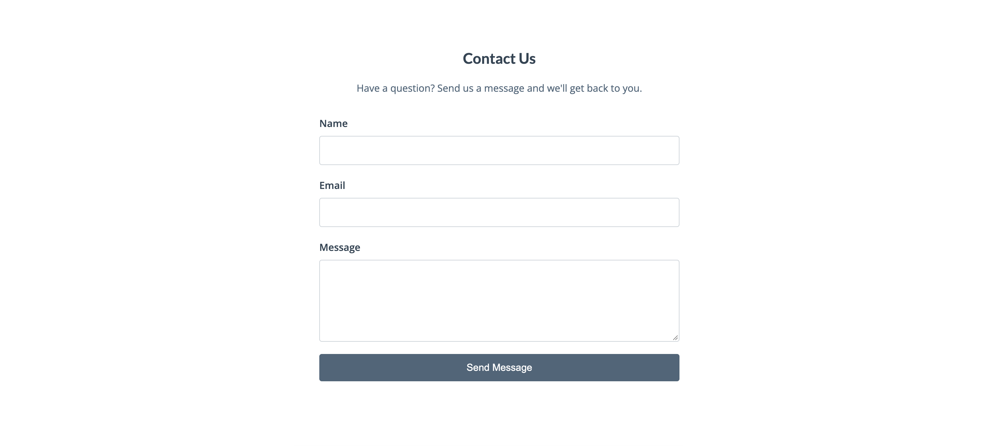 

### Future Enhancements
Due to the project deadline, some additional features could not be implemented within the development timeframe. These have been identified as potential future enhancements for Elite Rides:

- Online Payments: Integrate a secure payment system to allow customers to pay for their reservations directly through the website.
- Interactive Map: Add a map showing the business location and vehicle collection points to help customers find them easily.
- Advanced Search and Filters: Introduce additional filtering options, such as price range, number of seats and transmission type.
- Customer Profiles: Expand customer account functionality to include personal details and preferences.
- Booking Reminders: Introduce automated email reminders for upcoming reservations.
- Vehicle Availability Calendar: Provide a calendar view of vehicle availability to make selecting rental dates easier.

## The Skeleton Plane

### Wireframes
To create the following wireframes I used [Marvel App](http://marvelapp.com/)

Homepage
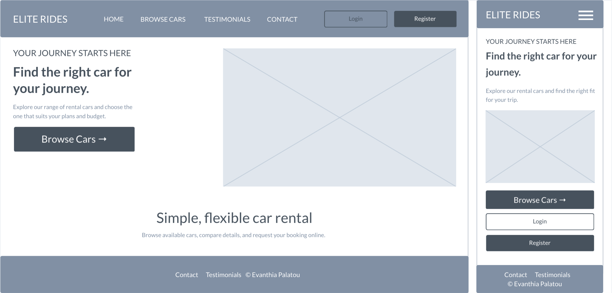

Car List
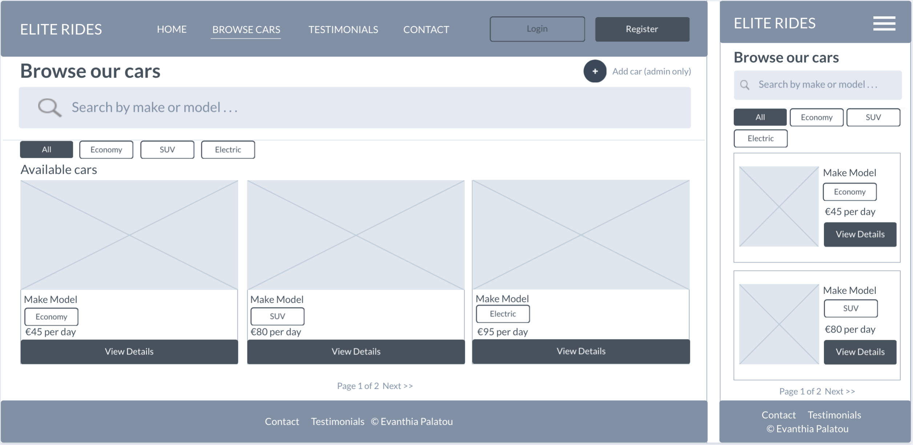

Car Detail
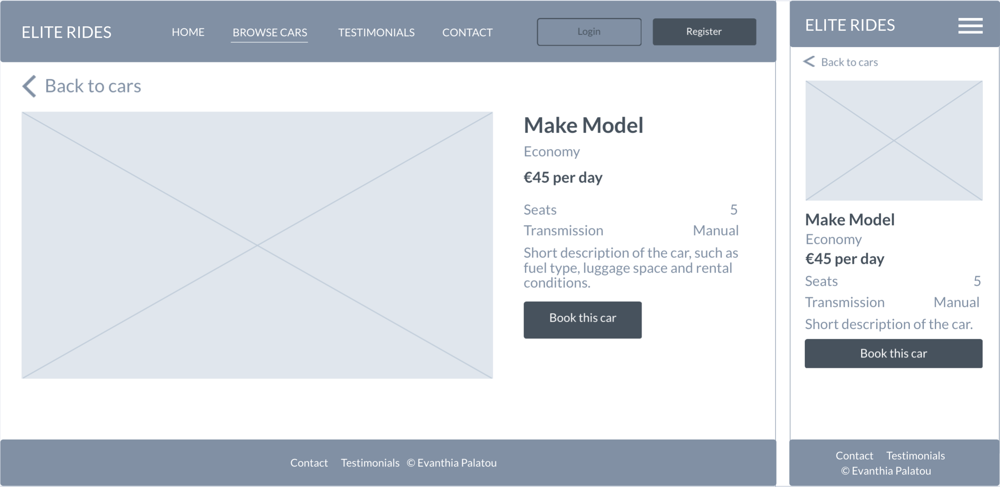

Booking Form
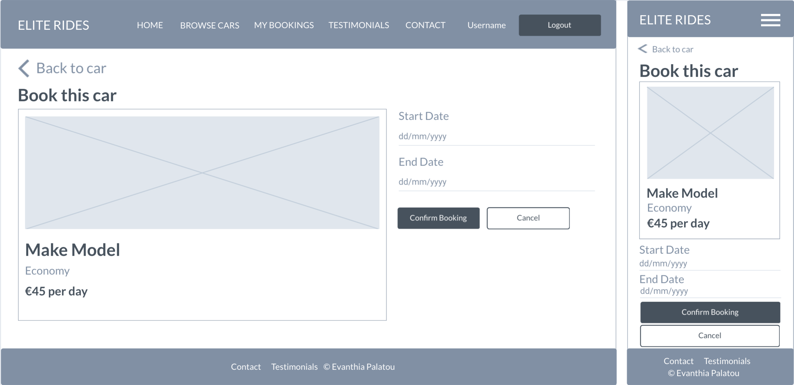

My Bookings
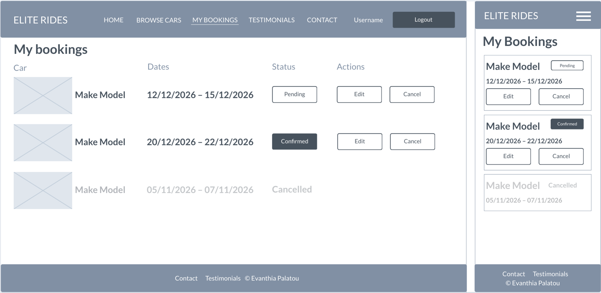

Register
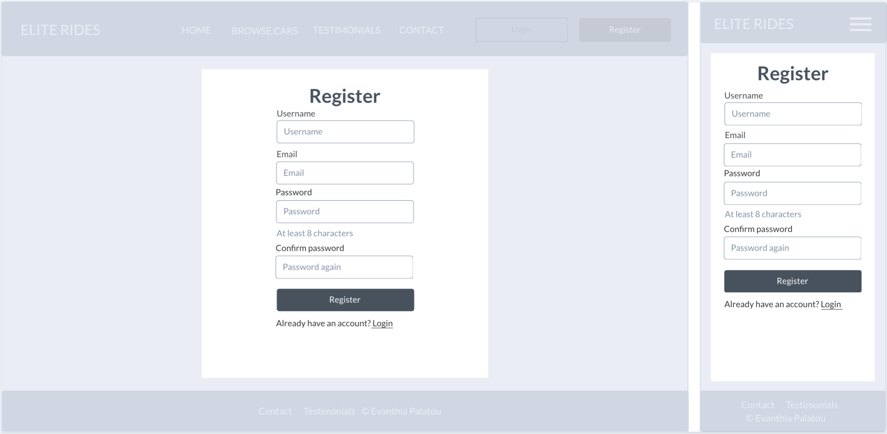

Login
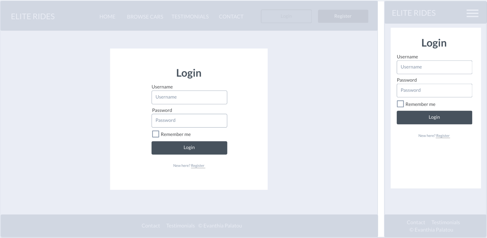

Car List (admin)
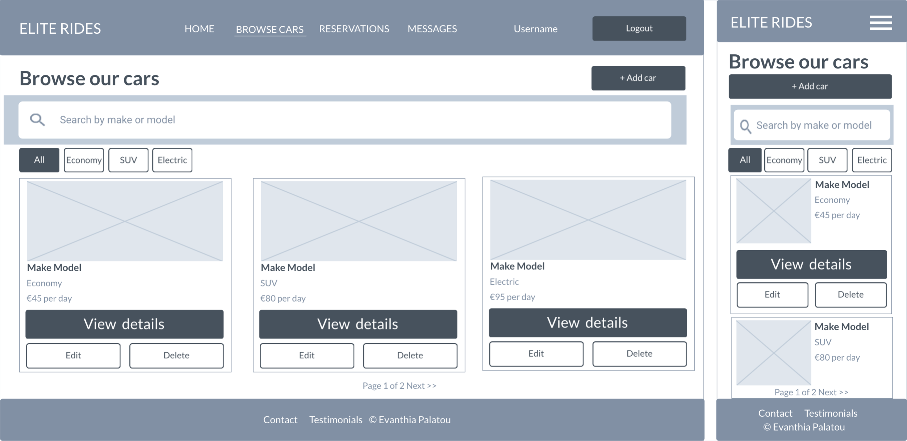

Car Form
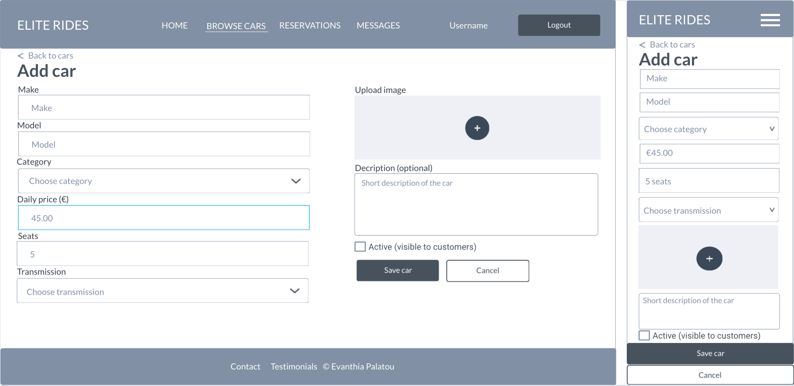

Reservations
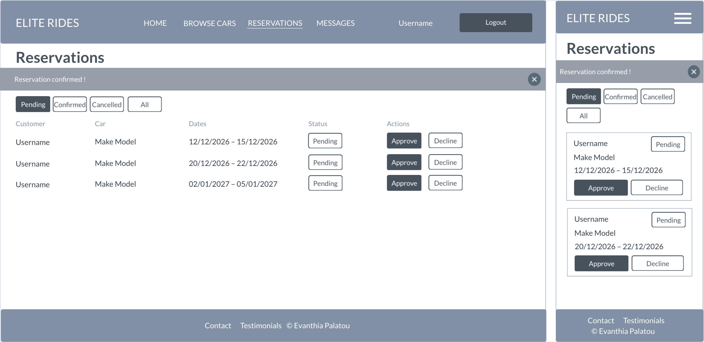

Contact Us
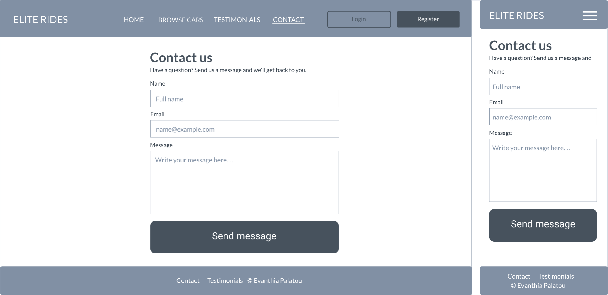

Testimonials
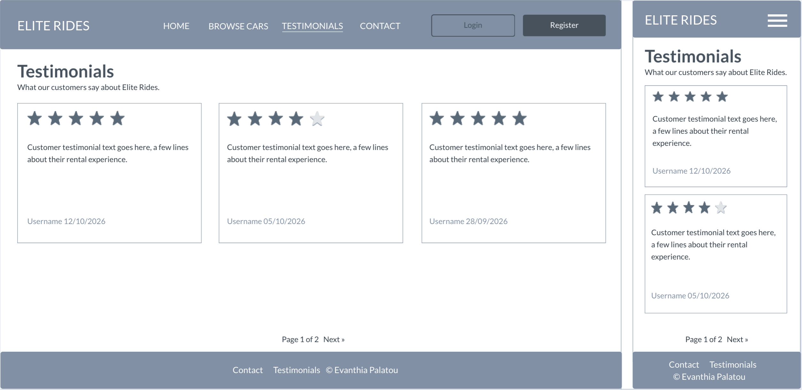

### Database Design

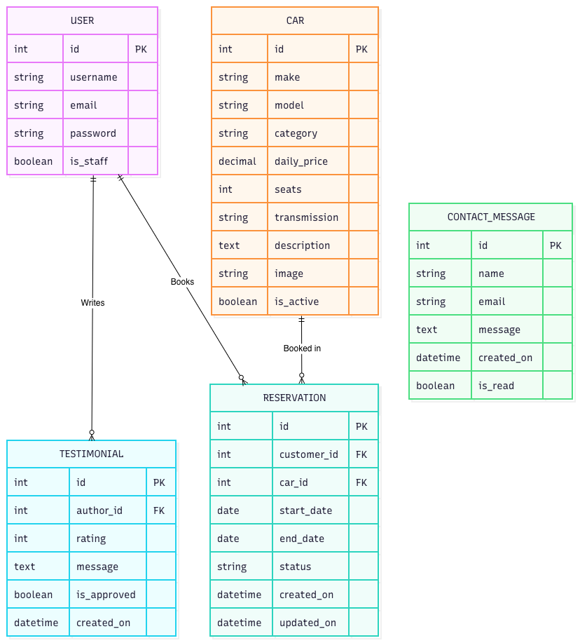

### Security
Security was an important consideration throughout the development of Elite Rides. Django's built-in security features and authentication system were used to help protect user accounts, customer information and application functionality.

The following security measures were implemented:
- User Authentication: Django Allauth provides user registration, login, logout and password reset functionality.
- Password Security: User passwords are securely hashed by Django rather than stored as plain text. Password validation is used to enforce password requirements.
- Access Control: Login requirements protect customer-only functionality, while staff-only permissions restrict administrative features.
- Authorisation: Customers can only view and manage their own reservations. Administrative actions are restricted to authorised staff members.
- CSRF Protection: Django's CSRF protection helps prevent unauthorised form submissions.
- SQL Injection Protection: Django's ORM is used for database queries, helping protect against SQL injection attacks.
- Environment Variables: Sensitive configuration values, including the secret key, database credentials and email credentials, are stored in environment variables rather than committed to the GitHub repository.
- Production Settings: Debug mode is disabled in the production environment to avoid exposing sensitive debugging information.
- Secure Database Relationships: Reservation records are associated with their respective customers and vehicles, helping maintain data integrity.

## The Surface Plane

### Design
The design of Elite Rides focuses on creating a clean, modern and user-friendly experience that reflects the convenience and professionalism of a car rental service. A simple layout, clear navigation and consistent styling help users explore the website and access its features easily. The blue-grey header and footer frame the white content areas, creating a balanced and uncluttered appearance. The website follows a responsive design approach, adapting to desktop, tablet and mobile screens. Vehicle cards, clearly structured forms and consistent buttons help maintain a straightforward browsing and booking experience across all devices.

### Color Scheme
The colour palette for Elite Rides combines muted blue-grey tones with white backgrounds to create a clean, professional and welcoming appearance. The primary slate blue-grey shade #526579 is used for the header, footer, buttons and other accents, providing visual consistency throughout the website. White #ffffff is used for the main content backgrounds and contrasting text, keeping the interface bright and easy to read. Dark slate #354454 provides contrast for body text, while softer grey shades such as #aab5bf and #d5dbe0 are used for borders and card outlines. Light grey #f1f2f3 is used for notification messages, ensuring that feedback is clearly visible without distracting from the main content.

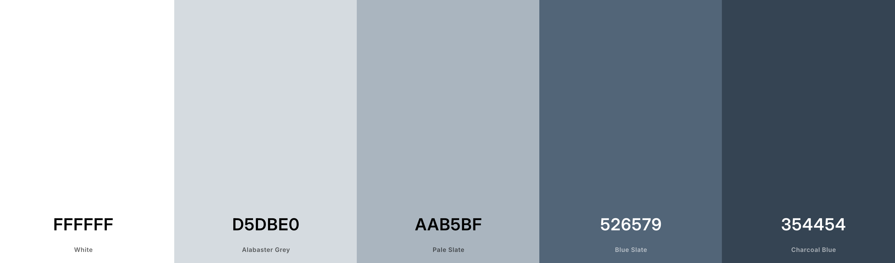

### Typography
Elite Rides uses two complementary sans-serif typefaces, Lato and Open Sans, to create a consistent and readable visual identity. Lato is used for headings throughout the website, providing a clean and modern appearance that gives titles a clear visual presence. Open Sans is used for body text, forms, buttons, inputs and other interface elements, ensuring readability and consistency across different sections. Together, these fonts create a balanced design that prioritises clarity and ease of navigation.

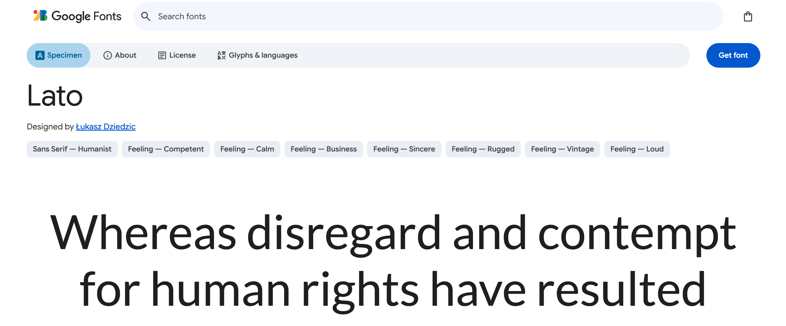

### Imagery
Imagery plays an important role in introducing the car rental service and helping customers explore the available vehicles. The homepage features a prominent hero image that supports the website's welcoming introduction and reinforces its focus on car rentals. Vehicle photographs are also displayed throughout the Browse Cars page and individual car detail pages, allowing customers to see the vehicles before making a reservation. Images are presented using responsive styling to maintain a consistent appearance across desktop, tablet and mobile devices.

## Technologies Used
### Core Technologies
- HTML5: Used to structure the website content and Django templates.
- CSS3: Used to style the website, create layouts and implement responsive design.
- JavaScript: Used to provide interactive functionality on the frontend.
- Python: Used as the main programming language for the application.
- Django 4.2.19: Python web framework used to build the application, manage database operations, authentication and backend functionality.
- Django Allauth: Used to provide user registration, login, logout and password reset functionality.
- PostgreSQL: Relational database used to store application data.
- Neon: Used to host the PostgreSQL database.

### Additional Technologies and Services
- Cloudinary: Used for cloud-based image storage and management.
- WhiteNoise: Used to serve static files in the production environment.
- Gunicorn: Used as the WSGI HTTP server for the Django application.
- Heroku: Used to deploy and host the live application.
- Font Awesome: Used to provide social media icons in the website footer.

### Development Tools and Resources
- Git: Used for version control and tracking changes throughout development.
- GitHub: Used to host the project repository, manage issues and organise development using a Kanban board.
- Visual Studio Code: Used as the code editor and development environment.
- draw.io: Used to create project diagrams and visual documentation.
- Marvel App: Used to create project wireframes
- Google Fonts: Used to source the typography for the website.
- Coolors: Color Palette generator
- Unsplash: copyright free images

## Testing
I have included details of testing in a separate file [TESTING.md](https://github.com/evapalatou/car-rental-app/blob/main/TESTING.md)

### Fixed Bugs
### Unfixed Errors

## Deployment

### Version Control

### Heroku Deployment

### Run Locally

### Fork Project

## Credits

