<h1 align="center">🏎 Elite Rides Car Rental 🏎</h1>

* [Elite Rides Car Rental](#elite-rides-car-rental)
* [User Experience Design](#user-experience-design)
    * [The Strategy Plane](#the-strategy-plane)
        * [Site Goals](#site-goals)
        * [Agile Planning](#agile-planning)
            * [Epics](#epics)
            * [User Stories](#user-stories)
    * [The Scope Plane](#the-scope-plane)
    * [The Structure Plane](#the-structure-plane)
       * [Features](#features)
       * [Future Enhancements](#future-enhancements)
    * [The Skeleton Plane](#the-skeleton-plane)
       * [Wireframes](#wireframes)
       * [Database Design](#database-design)
       * [Security](#security)
    * [The Surface Plane](#the-surface-plane)
       * [Design](#design)
       * [Color Scheme](#color-scheme)
       * [Typography](#typography)
       * [Imagery](#imagery)
   * [Technologies Used](#technologies-used)
   * [Manual Testing](#manual-testing)
       * [Fixed Bugs](#fixed-bugs)
       * [Unfixed Errors](#unfixed-errors)
   * [Deployment](#deployment)
       * [Version Control](#version-control)
       * [Heroku Deployment](#heroku-deployment)
       * [Run Locally](#run-locally)
       * [Fork Project](#fork-project)
   * [Credits](#credits)

# User Experience Design

## The Strategy Plane

### Site Goals
### Agile Planning

#### User Stories: [Car Rental Kanban Board](https://github.com/users/evapalatou/projects/4)

**Epic 1: Accounts**
- As a new user, I want to register an account so that I can book cars.
- As a site user, I want to log in and out so that my bookings stay private.
- As a site user, I want to see that I’m logged in so that I know my session state.
- As a site user, I want to reset a forgotten password so that I can get back into my account.
- As a new user, I want to be sent to the login page if I open a booking page so that restricted pages stay protected.

**Epic 2: Browse Cars and Navigate**
- As a new user, I want to browse the available cars so that I can see what’s on offer.
- As a new user, I want to view a car’s details so that I can decide if it suits me.
- As a new user, I want to filter cars by category so that I can narrow my choice.
- As a new user, I want to search for cars by make or model so that I can find a specific car quickly.
- As a new user, I want to understand what the site offers so that I can quickly reach the cars.

**Epic 3: Reservations**
- As a site user, I want to book a car for a date range so that it’s reserved for me.
- As a site user, I want to be told when my dates aren’t available so that I can choose others.
- As a site user, I want to see my bookings so that I can keep track of them.
- As a site user, I want to edit my booking so that I can change my plans.
- As a site user, I want to cancel my booking so that I don’t hold a car I don’t need.
- As a site admin, I want to approve or decline reservations so that I control the fleet.

**Epic 4: Fleet Management**
- As a site admin, I want to add a car so that the fleet stays up to date.
- As a site admin, I want to edit a car so that I can change its price or details.
- As a site admin, I want to delete a car so that unavailable cars are removed.

**Epic 5: Contact**
- As a new user, I want to send a message through a contact form so that I can ask the owner a question.
- As a site admin, I want to read the contact messages so that I can reply to them.

**Epic 6: Testimonials**
- As a site user, I want to write a testimonial so that I can share my experience.
- As a site admin, I want to approve testimonials so that I control what shows.

## The Scope Plane

## The Structure Plane

### Features
### Future Enhancements

## The Skeleton Plane

### Wireframes

Homepage
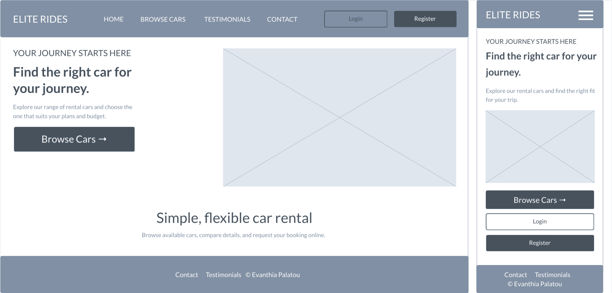

Car List
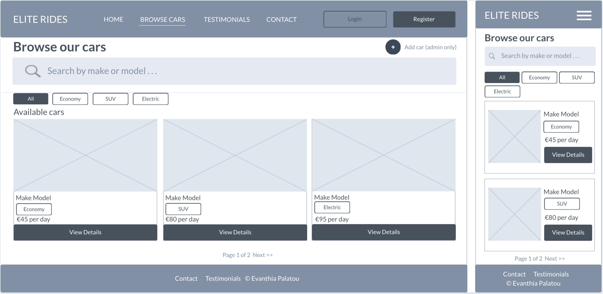

Car Detail
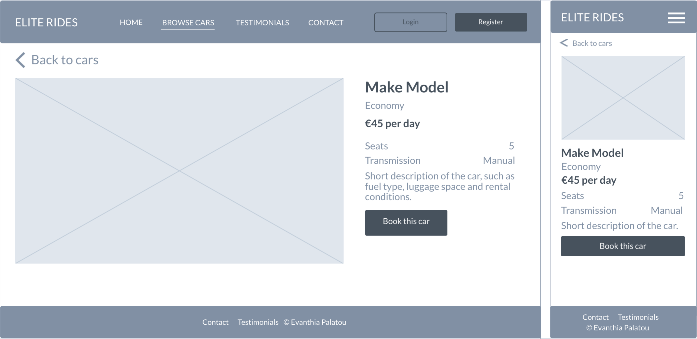

Booking Form
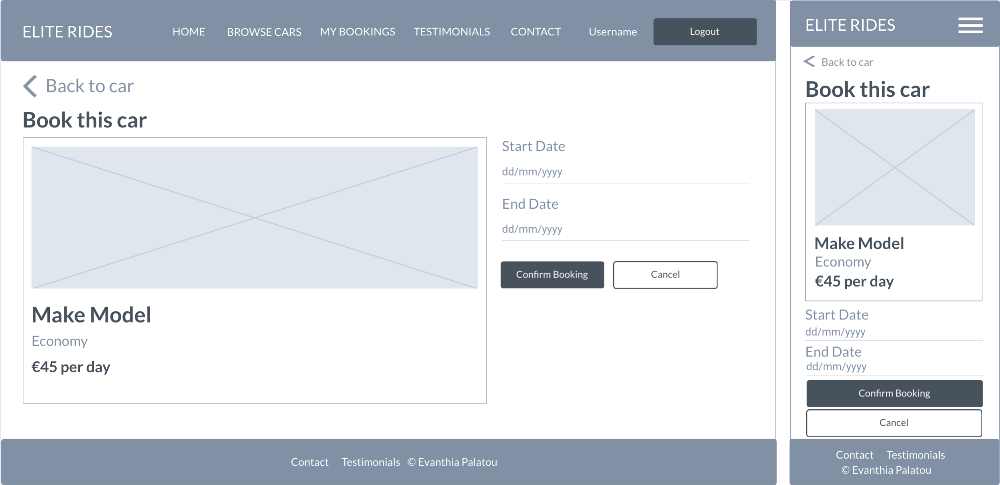

My Bookings
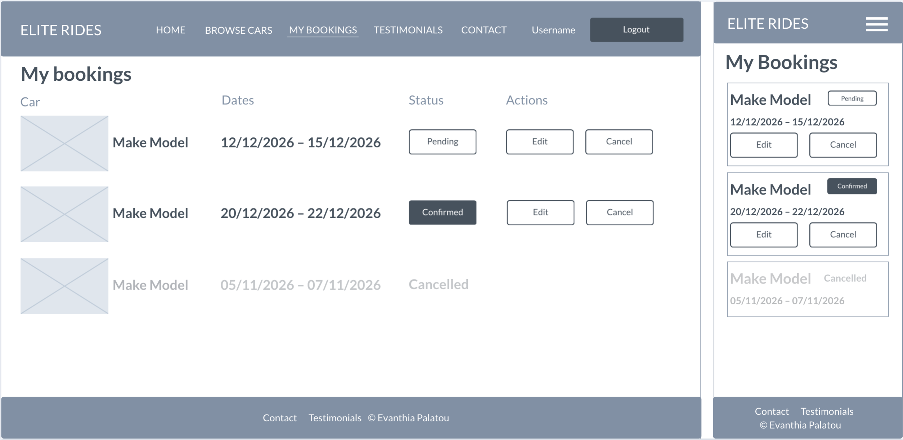

Register
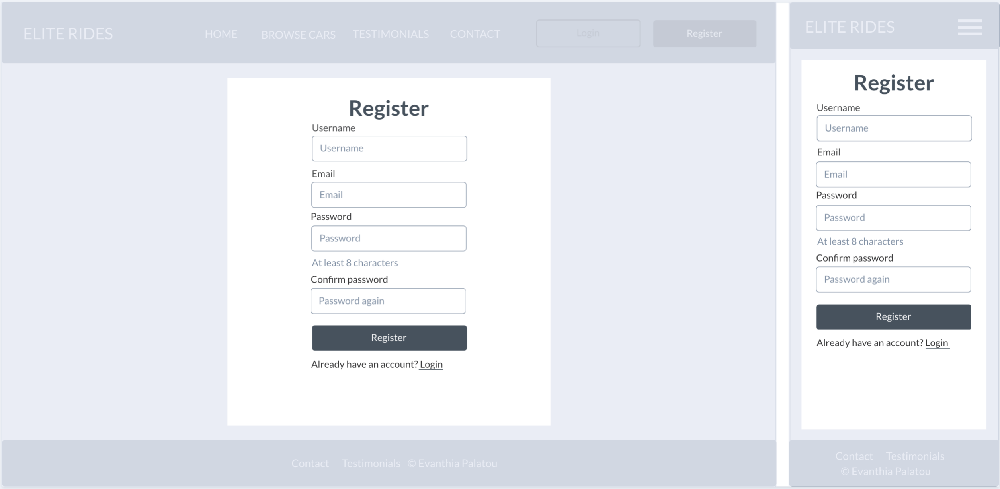

Login
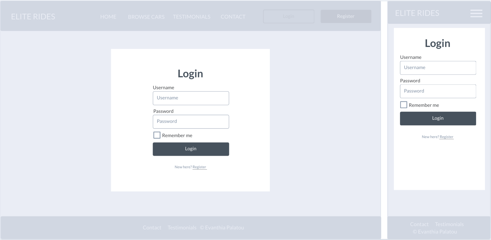

Car List (admin)
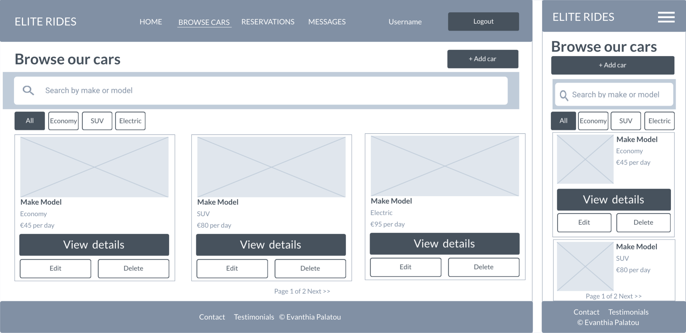

Car Form
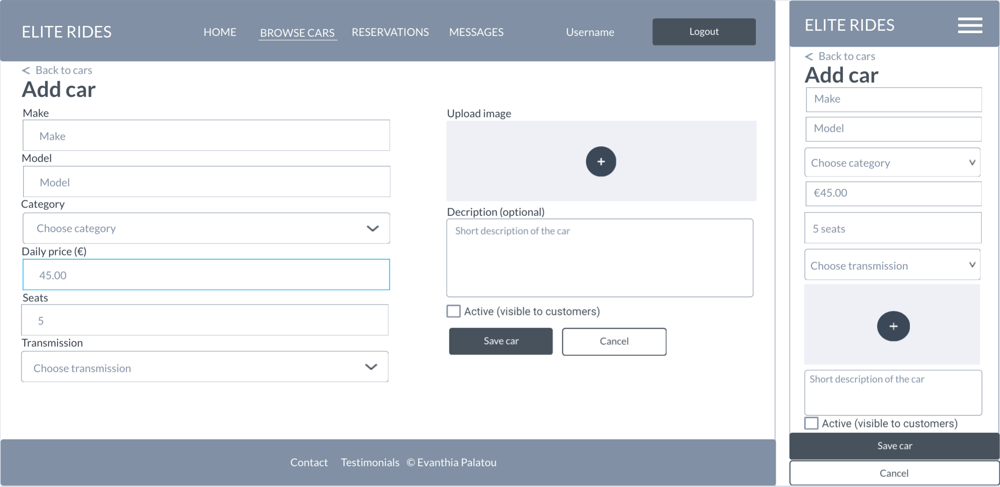

Reservations
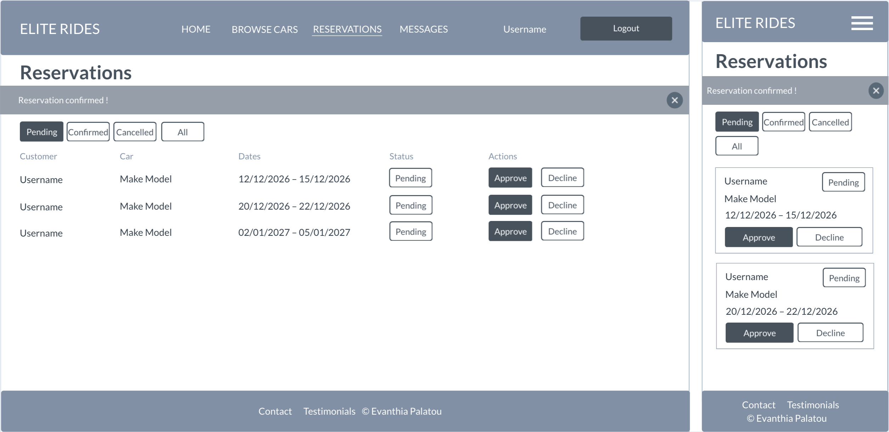

Contact Us
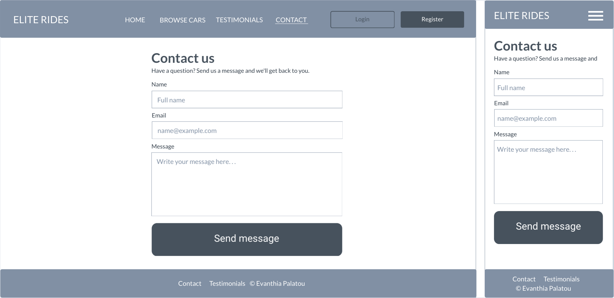

Testimonials
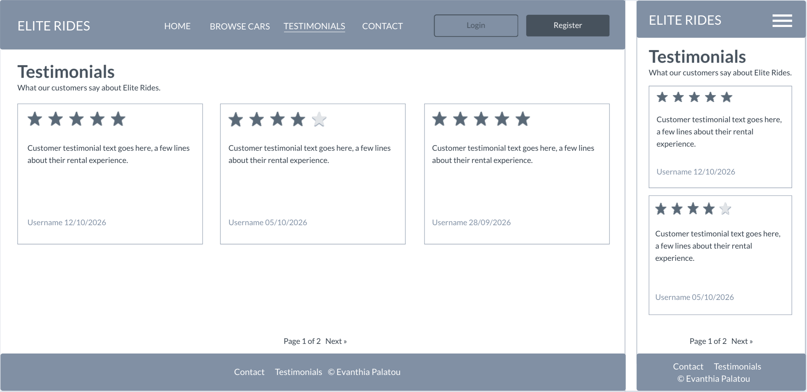

### Database Design

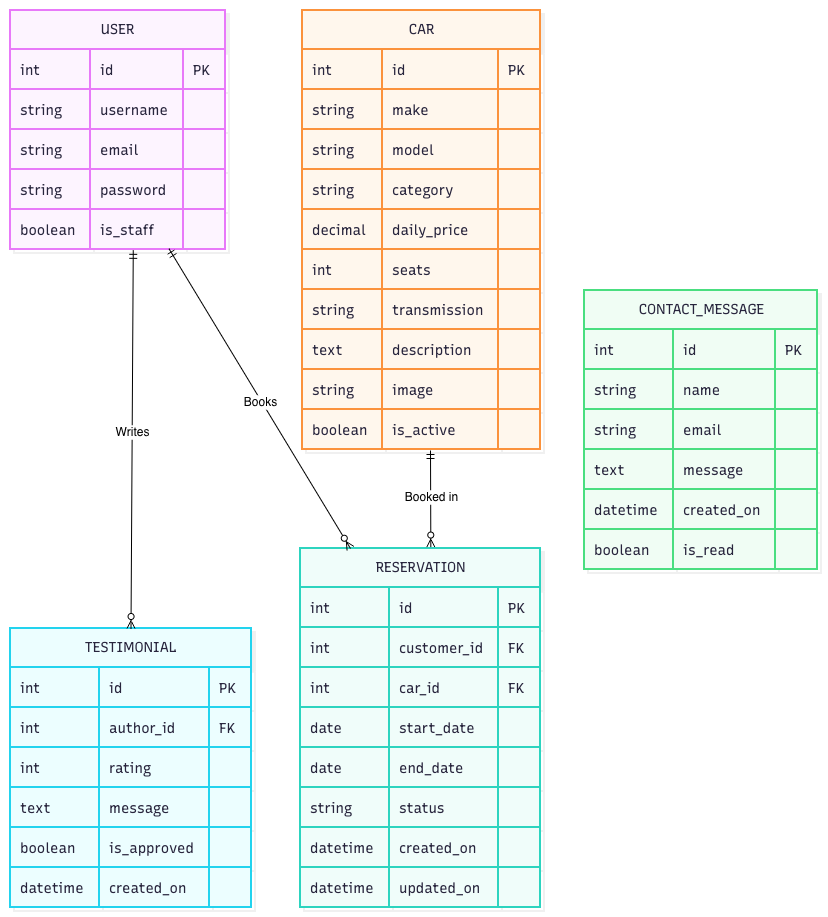

### Security

## The Surface Plane

### Design
### Color Scheme
### Typography
### Imagery

## Technologies Used

## Manual Testing

### Fixed Bugs
### Unfixed Errors

## Deployment

### Version Control

### Heroku Deployment

### Run Locally

### Fork Project

## Credits

