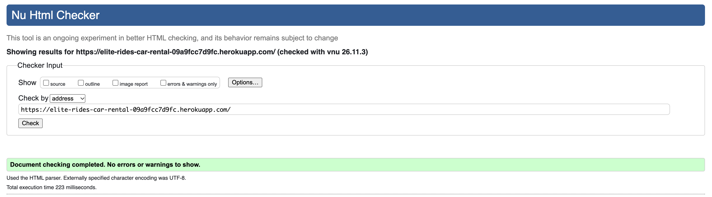
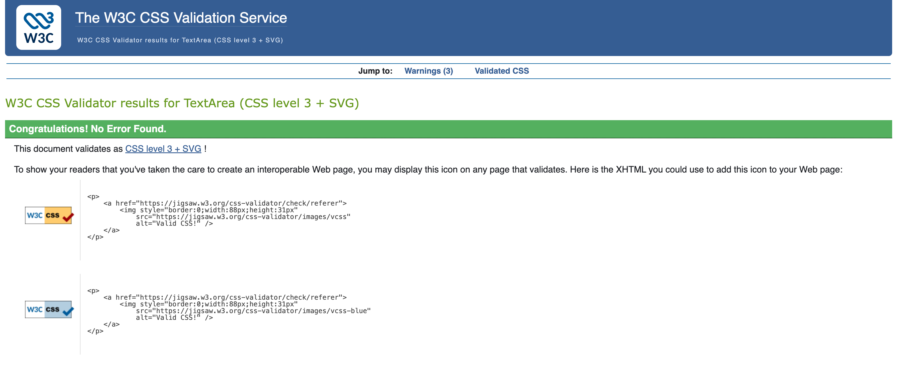

## Code Validation
### HTML
All HTML pages were validated using the [W3C HTML Validator](https://validator.w3.org/).

| PAGE | VALIDATOR SCREENSHOT | RESULT |
|---|---|---|
| Home Page | 

Home

 | PASS |
| Browse Cars Page | [HTML Browse Cars](readme/testing/browse-cars.png) | FAIL |
| Car Details Page | [HTML Car Details](readme/testing/car-details.png) | PASS |
| Sign Up Page | [HTML Registration](readme/testing/registration.png) | FAIL |
| Login Page | [HTML Login](readme/testing/html/login.png) | PASS |
| Testimonials Page | [HTML Testimonials](readme/testing/html/testimonials.png) | FAIL |
| Contact Page | [HTML Contact](readme/testing/html/contact.png) | PASS |

### CSS
CSS was validated using [Jigsaw W3](https://jigsaw.w3.org/css-validator/validator).

| PAGE | VALIDATOR SCREENSHOT | RESULT |
|---|---|---|
| Home Page | 

style.css

 | PASS |