## Code Validation
### HTML
All HTML pages were validated using the [W3C HTML Validator](https://validator.w3.org/).

| PAGE | VALIDATOR SCREENSHOT | RESULT |
|---|---|---|
| Home Page | 

Home

 | PASS |
| Browse Cars Page | 

Browse Cars

 | FAIL |
| Car Details Page | 

Car Details

 | PASS |
| Registration Page | 

Registration

 | FAIL |
| Login Page | 

Login
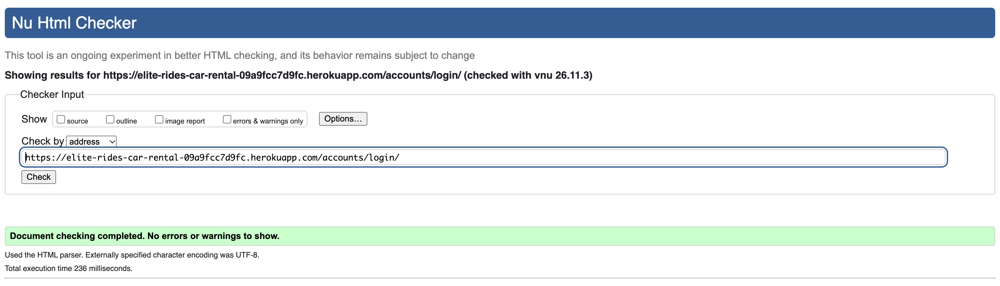
 | PASS |
| Testimonials Page | 

Testimonials
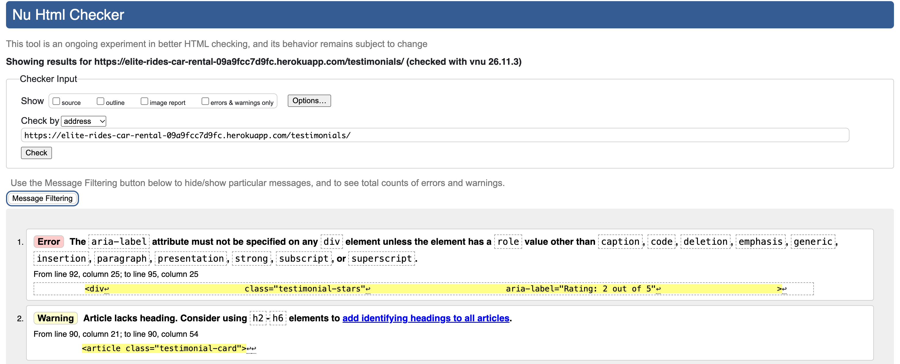
 | FAIL |
| Contact Page | 

Contact
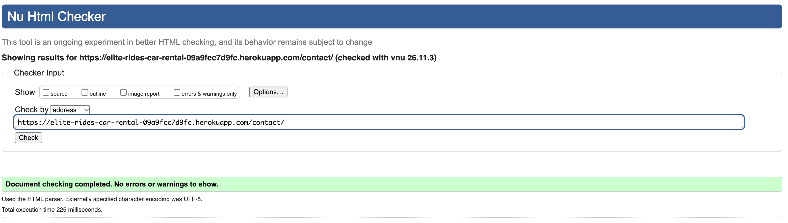
 | PASS |

### CSS
CSS was validated using [Jigsaw W3](https://jigsaw.w3.org/css-validator/).

| FILE | VALIDATOR SCREENSHOT | RESULT |
|---|---|---|
| style.css | 

style.css

 | PASS |

### JAVASCRIPT
JavaScript was validated using [JSHint](https://jshint.com/).

| FILE | VALIDATOR SCREENSHOT | RESULT |
|---|---|---|
| navigation.js | 

navigation.js
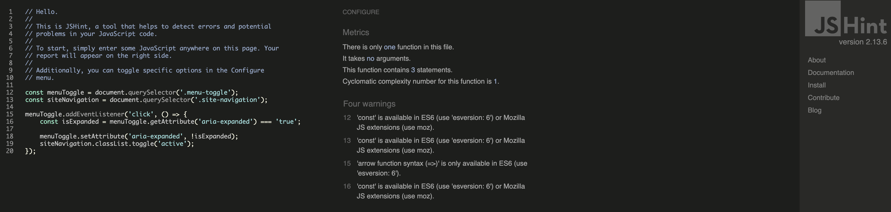
 | PASS (4 warnings) |

### PYTHON
Python was validated using [CI Python Linter](https://pep8ci.herokuapp.com/).

| FILE | VALIDATOR SCREENSHOT | RESULT |
|---|---|---|
| cars/admin.py | 

Cars Admin
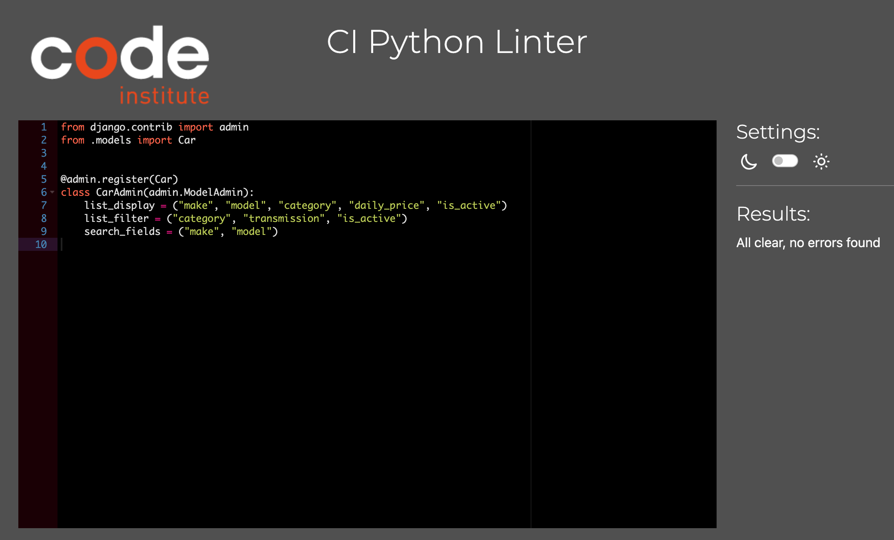
 | PASS |
| cars/apps.py | 

Cars Apps

 | PASS |
| cars/forms.py | 

Cars Forms

 | PASS |
| cars/models.py | 

Cars Models
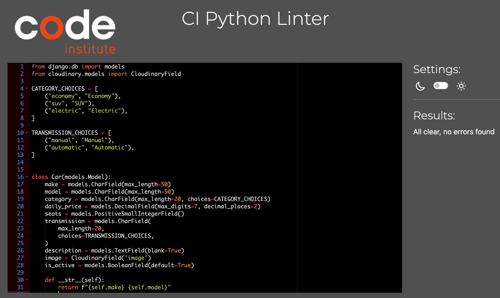
 | PASS |
| cars/views.py | 

Cars Views
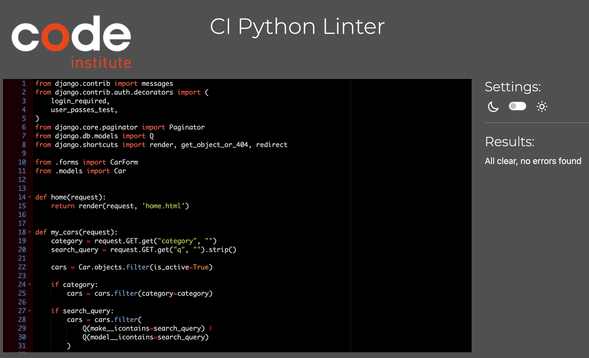
 | PASS |

## Lighthouse
For most of the pages Lighthouse reporting tool is not indicating Performance.

| PAGE | SCREENSHOT |
|---|---|
| Home | 

Home
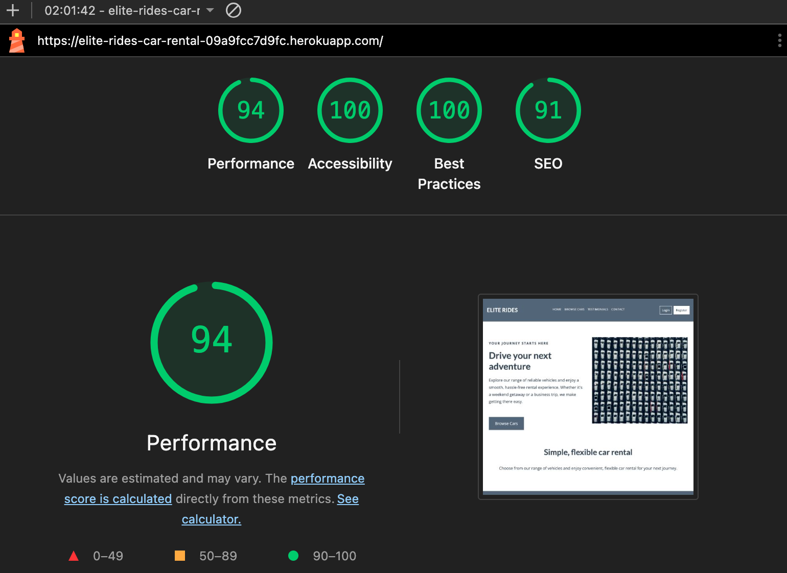
 | 
| Register | 

Register
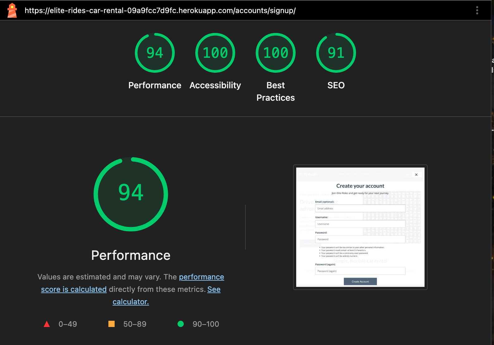
 | 
| Login | 

Login
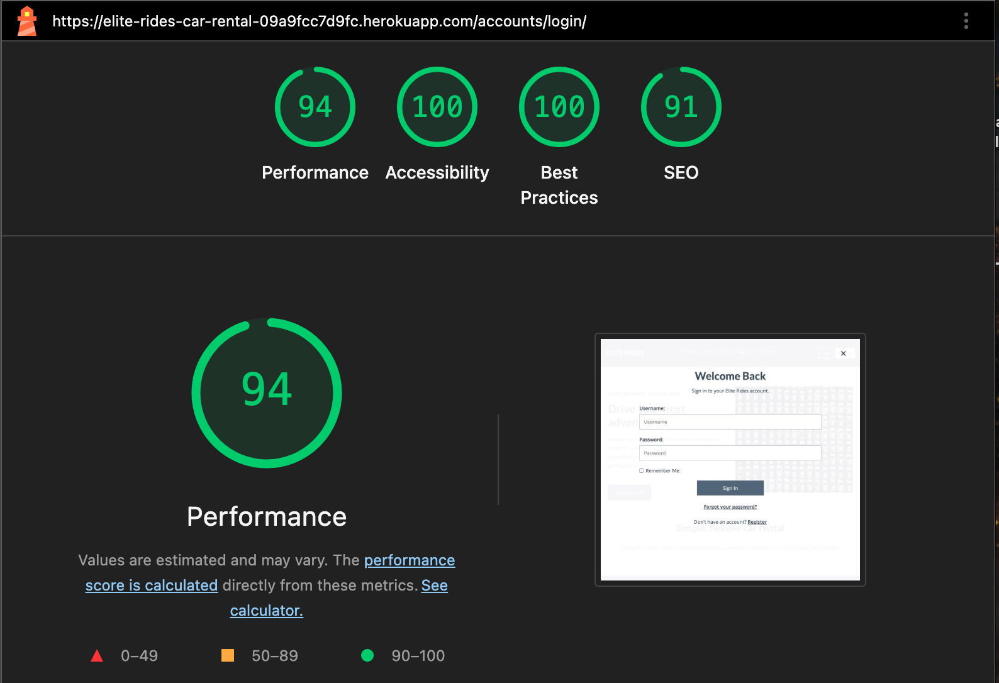
 | 
| Logout | 

Logout
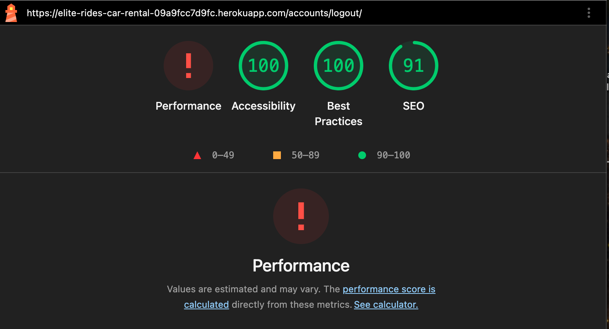
 |
| Browse Cars | 

Browse Cars
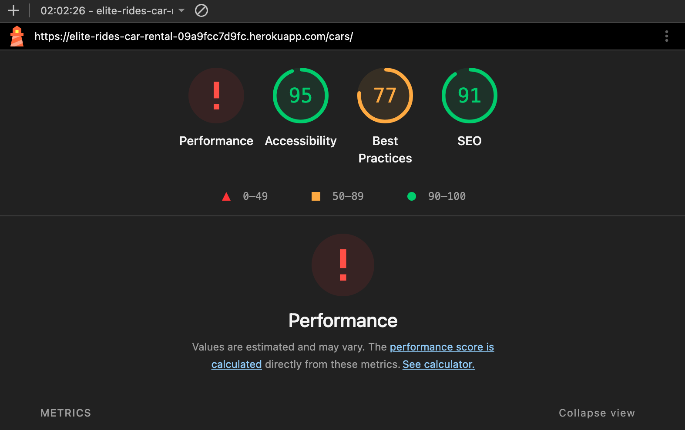
 |
| Car Details | 

Car Details
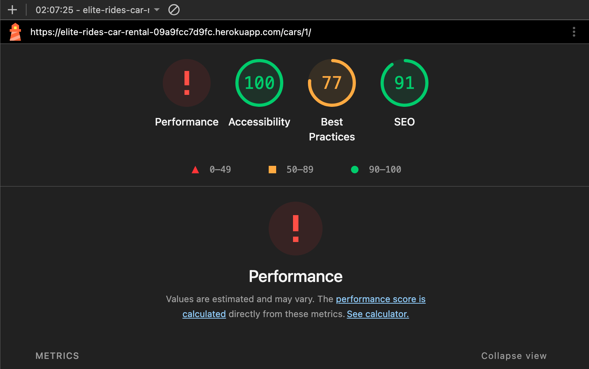
 | 
| My Bookings | 

My Bookings
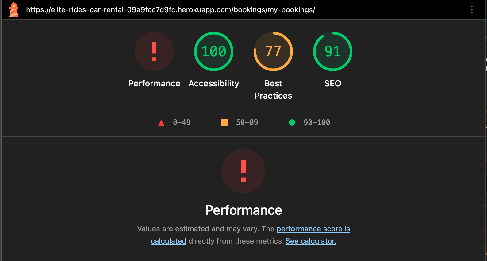
 | 
| Testimonials | 

Testimonials
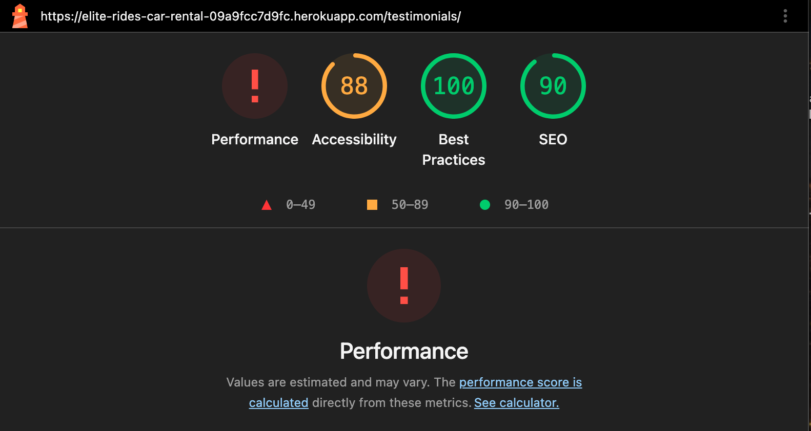
 | 
| Write Testimonial | 

Write Testimonial
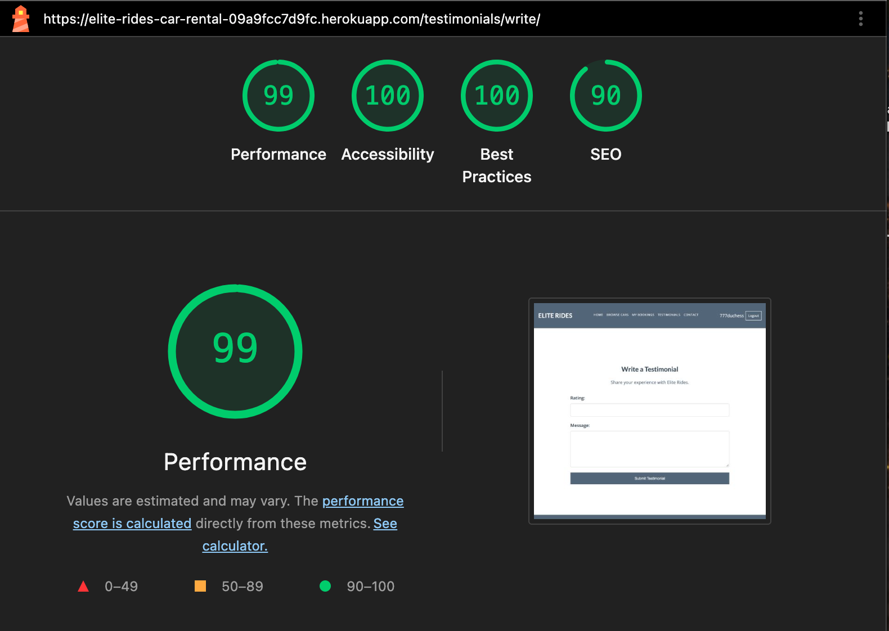
 | 
| Contact | 

Contact

 | 

## Manual Testing
### Navigation & Footer
| Test Name | Steps | Expected Result | Actual Result | Pass/Fail |
|---|---|---|---|---|
| Logo Navigation | 1. Click on the ELITE RIDES logo/title. | User is redirected to the homepage. | Same as expected | ✓ Pass |
| Home Navigation | 1. Click on the Home link. | User is redirected to the homepage. | Same as expected | ✓ Pass |
| Browse Cars Navigation | 1. Click on the Browse Cars link. | User is redirected to the car listing page. | Same as expected | ✓ Pass |
| Register Navigation | 1. While logged out, click on the Register link. | User is redirected to the registration page. | Same as expected | ✓ Pass |
| Login Navigation | 1. While logged out, click on the Login link. | User is redirected to the login page. | Same as expected | ✓ Pass |
| My Bookings Navigation | 1. Log in as a customer. 2. Click on the My Bookings link. | User is redirected to their bookings page. | Same as expected | ✓ Pass |
| Logout Navigation | 1. Log in to the website. 2. Click on the Logout link. 3. Confirm logout if prompted. | User is logged out and redirected to the homepage with a confirmation message. | Same as expected | ✓ Pass |
| Footer LinkedIn Link | 1. Scroll to the footer. 2. Click on the LinkedIn icon. | User is redirected to the LinkedIn profile. | Same as expected | ✓ Pass |
| Footer GitHub Link | 1. Scroll to the footer. 2. Click on the GitHub icon. | User is redirected to the GitHub profile. | Same as expected | ✓ Pass |

### Home Page
| Test Name | Steps | Expected Result | Actual Result | Pass/Fail |
|---|---|---|---|---|
| Homepage Visibility | 1. Navigate to the homepage. | The Elite Rides homepage loads successfully. | Same as expected | ✓ Pass |
| Welcome Heading Visibility | 1. Navigate to the homepage. | The main welcome heading and introductory text are visible. | Same as expected | ✓ Pass |
| Hero Image Visibility | 1. Navigate to the homepage. | The homepage hero image is displayed correctly. | Same as expected | ✓ Pass |
| Browse Cars Button | 1. Navigate to the homepage. 2. Click the Browse Cars button. | User is redirected to the car listing page. | Same as expected | ✓ Pass |
| Homepage Navigation | 1. Navigate to the homepage. 2. Click the ELITE RIDES logo/title. | User remains on or is redirected to the homepage. | Same as expected | ✓ Pass |
| Register Button Visibility | 1. Log out. 2. Navigate to the homepage. | The Register link is visible to logged-out visitors. | Same as expected | ✓ Pass |
| Login Button Visibility | 1. Log out. 2. Navigate to the homepage. | The Login link is visible to logged-out visitors. | Same as expected | ✓ Pass |
| Responsive Layout - Desktop | 1. Open the homepage on a desktop screen. | Homepage content is displayed correctly without unwanted horizontal scrolling. | Same as expected | ✓ Pass |
| Responsive Layout - Tablet | 1. Open the homepage on a tablet-sized screen. | Homepage content adjusts to the tablet screen size. | Same as expected | ✓ Pass |
| Responsive Layout - Mobile | 1. Open the homepage on a mobile-sized screen. | Homepage content adjusts to the mobile screen size without unwanted horizontal scrolling. | Same as expected | ✓ Pass |
| Mobile Navigation Menu | 1. Open the homepage on a mobile screen. 2. Click the hamburger menu. | The mobile navigation menu opens and displays the available navigation links. | Same as expected | ✓ Pass |
| Mobile Navigation Menu Close | 1. Open the mobile navigation menu. 2. Click the menu button again. | The mobile navigation menu closes. | Same as expected | ✓ Pass |
| Footer Visibility | 1. Navigate to the homepage. 2. Scroll to the bottom. | The footer displays the copyright text and social media links. | Same as expected | ✓ Pass |
| Footer LinkedIn Link | 1. Scroll to the footer. 2. Click the LinkedIn icon. | User is redirected to the LinkedIn profile. | Same as expected | ✓ Pass |
| Footer GitHub Link | 1. Scroll to the footer. 2. Click the GitHub icon. | User is redirected to the GitHub profile. | Same as expected | ✓ Pass |

### Register
| Test Name | Steps | Expected Result | Actual Result | Pass/Fail |
|---|---|---|---|---|
| Sign-Up Success | 1. Navigate to the Register page. 2. Enter valid registration details. 3. Submit the form. | User account is created successfully and the user is redirected to the homepage with a confirmation message. | Same as expected | ✓ Pass |
| Password Mismatch | 1. Navigate to the Register page. 2. Enter different passwords in the password fields. 3. Submit the form. | An error message informs the user that the passwords do not match. | Same as expected | ✓ Pass |
| Invalid Email Format | 1. Enter an invalid email address. 2. Submit the form. | An error message informs the user to enter a valid email address. | Same as expected | ✓ Pass |
| Password Too Similar to Personal Information | 1. Enter a password similar to the username or email address. 2. Submit the form. | An error message explains that the password is too similar to personal information. | Same as expected | ✓ Pass |
| Password Less Than 8 Characters | 1. Enter a password with fewer than 8 characters. 2. Submit the form. | An error message explains that the password must contain at least 8 characters. | Same as expected | ✓ Pass |
| Commonly Used Password | 1. Enter a commonly used password, such as password123. 2. Submit the form. | An error message explains that the password is too common. | Same as expected | ✓ Pass |
| Password Entirely Numeric | 1. Enter a password containing only numbers, such as 12345678. 2. Submit the form. | An error message explains that the password cannot be entirely numeric. | Same as expected | ✓ Pass |
| Show/Hide Password Toggle | 1. Click the show/hide password icon. 2. Verify that password visibility switches between hidden and visible. | Password visibility toggles correctly. | Same as expected | ✓ Pass |

### Login
| Test Name | Steps | Expected Result | Actual Result | Pass/Fail |
|---|---|---|---|---|
| Navigate to Sign-Up Page | 1. Navigate to the Login page. 2. Click on the Register or Sign Up link. | User is redirected to the registration page. | Same as expected | ✓ Pass |
| Sign-In Success | 1. Navigate to the Login page. 2. Enter a valid username and password. 3. Submit the form. | User is successfully logged in and redirected to the homepage with a confirmation message. | Same as expected | ✓ Pass |
| Incorrect Credentials | 1. Navigate to the Login page. 2. Enter an incorrect username or password. 3. Submit the form. | An error message informs the user that the login credentials are incorrect. | Same as expected | ✓ Pass |
| Forgot Password Link | 1. Navigate to the Login page. 2. Click on the Forgot Password link. | User is redirected to the password recovery page. | Same as expected | ✓ Pass |
| Remember Me Checkbox | 1. Navigate to the Login page. 2. Enter valid credentials. 3. Select the Remember Me checkbox. 4. Submit the form. | User remains logged in according to the configured session expiry settings. | Same as expected | ✓ Pass |
| Empty Credentials | 1. Navigate to the Login page. 2. Leave the username and password fields empty. 3. Submit the form. | Validation messages indicate that the required fields must be completed. | Same as expected | ✓ Pass |

### Browse Cars
| Test Name | Steps | Expected Result | Actual Result | Pass/Fail |
|---|---|---|---|---|
| Car Listings Visibility | 1. Navigate to the Browse Cars page. | Available cars are displayed with their images and key information. | Same as expected | ✓ Pass |
| Car Information Display | 1. Open the Browse Cars page. 2. Inspect the displayed car cards. | Each car displays its make, model, category, transmission, number of seats and daily rental price. | Same as expected | ✓ Pass |
| Search Cars by Make | 1. Navigate to the Browse Cars page. 2. Enter a car make in the search field. | Cars matching the entered make are displayed. | Same as expected | ✓ Pass |
| Search Cars by Model | 1. Enter a car model in the search field. | Cars matching the entered model are displayed. | Same as expected | ✓ Pass |
| Search with No Matching Results | 1. Enter a search term that does not match any available car. | An appropriate message is displayed indicating that no cars were found. | Same as expected | ✓ Pass |
| Filter Cars by Category | 1. Open the Browse Cars page. 2. Select a category, such as Economy, SUV or Electric. | Only cars belonging to the selected category are displayed. | Same as expected | ✓ Pass |
| Clear Search and Filters | 1. Apply a search term or category filter. 2. Clear the search or reset the filter. | The car listing updates to show the cars matching the remaining criteria or all available cars when cleared. | Same as expected | ✓ Pass |
| View Car Details | 1. Navigate to the Browse Cars page. 2. Click View Details on a selected car. | User is redirected to the selected car's details page. | Same as expected | ✓ Pass |
| Inactive Cars Visibility | 1. Log in as an administrator. 2. Deactivate a car. 3. Visit the Browse Cars page as a customer. | Deactivated cars are not displayed in the available car listings. | Same as expected | ✓ Pass |
| Empty Car Listings | 1. Search or filter for cars with no matching available results. | An appropriate empty-state message is displayed. | Same as expected | ✓ Pass |

### Testimonials Page
| Test Name | Steps | Expected Result | Actual Result | Pass/Fail |
|---|---|---|---|---|
| Testimonials Display | 1. Navigate to the Testimonials page. | Approved testimonials are displayed with the customer's name, rating, message and submission date. | Same as expected | ✓ Pass |
| Testimonial Rating Display | 1. Navigate to the Testimonials page. 2. Inspect the ratings displayed on testimonials. | Each testimonial displays its submitted rating correctly. | Same as expected | ✓ Pass |
| Unapproved Testimonials Visibility | 1. Log in as an administrator. 2. Submit or locate an unapproved testimonial. 3. View the Testimonials page as a visitor. | Unapproved testimonials are not visible to visitors. | Same as expected | ✓ Pass |
| Add Your Testimonial Navigation | 1. Log in as a customer. 2. Navigate to the Testimonials page. 3. Click the Add Your Testimonial button. | User is redirected to the form for submitting a testimonial. | Same as expected | ✓ Pass |
| Submit Testimonial | 1. Log in as a customer. 2. Open the testimonial submission form. 3. Enter a rating and testimonial message. 4. Submit the form. | The testimonial is submitted successfully and a confirmation message is displayed. | Same as expected | ✓ Pass |
| Testimonial Approval | 1. Log in as an administrator. 2. Open the testimonial management page. 3. Approve a pending testimonial. | The testimonial is approved and becomes visible on the Testimonials page. | Same as expected | ✓ Pass |
| Testimonial Decline or Removal | 1. Log in as an administrator. 2. Open the testimonial management page. 3. Decline or remove a testimonial, if supported. | The testimonial is no longer displayed publicly. | Same as expected | ✓ Pass |
| Customer Access Restriction | 1. Log out. 2. Navigate to the testimonial submission page. | Logged-out visitors cannot submit a testimonial and are prompted to log in. | Same as expected | ✓ Pass |

### Contact Page
| Test Name | Steps | Expected Result | Actual Result | Pass/Fail |
|---|---|---|---|---|
| Contact Page Visibility | 1. Navigate to the Contact page. | The Contact page and enquiry form are displayed correctly. | Same as expected | ✓ Pass |
| Contact Form Submission | 1. Enter a name in the Name field. 2. Enter a valid email address. 3. Enter a message. 4. Click the Send Message button. | The enquiry is submitted successfully and a confirmation message is displayed. | Same as expected | ✓ Pass |
| Contact Form Validation | 1. Leave all required fields empty. 2. Click the Send Message button. | Validation messages indicate that the required fields must be completed. | Same as expected | ✓ Pass |
| Invalid Email Address | 1. Enter a name. 2. Enter an invalid email address. 3. Enter a message. 4. Submit the form. | A validation message indicates that a valid email address is required. | Same as expected | ✓ Pass |
| Contact Message Management | 1. Log in as an administrator. 2. Navigate to the message management page. | Submitted customer enquiries are displayed for the administrator to review. | Same as expected | ✓ Pass |
| Contact Message Details | 1. Log in as an administrator. 2. Open a submitted contact message. | The administrator can view the message details, including the sender's name, email address and message. | Same as expected | ✓ Pass |
| Contact Message Deletion | 1. Log in as an administrator. 2. Delete a submitted contact message. 3. Confirm the deletion if prompted. | The selected contact message is deleted successfully and a confirmation message is displayed. | Same as expected | ✓ Pass |
| Customer Access Restriction | 1. Log out. 2. Attempt to access the contact message management page. | Visitors cannot access the message management page and are redirected or shown an appropriate access restriction. | Same as expected | ✓ Pass |