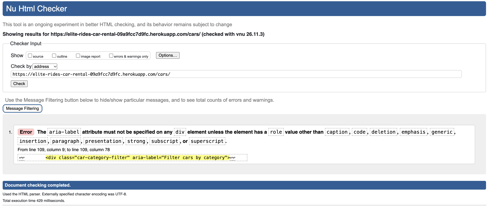
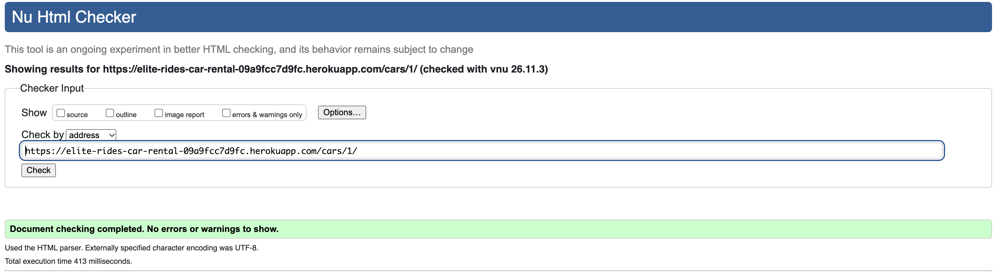
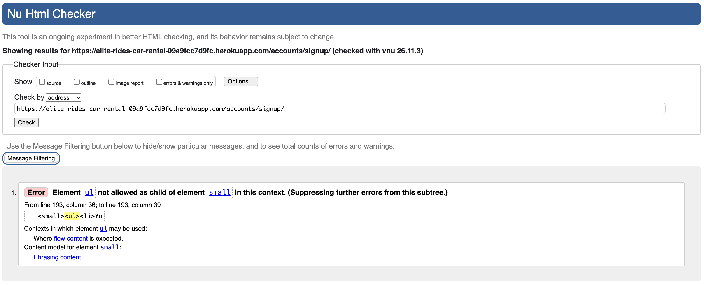

## Code Validation
### HTML
All HTML pages were validated using the [W3C HTML Validator](https://validator.w3.org/).

| PAGE | VALIDATOR SCREENSHOT | RESULT |
|---|---|---|
| Home Page | 

Home

 | PASS |
| Browse Cars Page | 

Browse Cars

 | FAIL |
| Car Details Page | 

Car Details

 | PASS |
| Registration Page | 

Registration

 | FAIL |
| Login Page | 

Login

 | PASS |
| Testimonials Page | 

Testimonials

 | FAIL |
| Contact Page | 

Contact

 | PASS |

### CSS
CSS was validated using [Jigsaw W3](https://jigsaw.w3.org/css-validator/validator).

| PAGE | VALIDATOR SCREENSHOT | RESULT |
|---|---|---|
| Home Page | 

style.css

 | PASS |